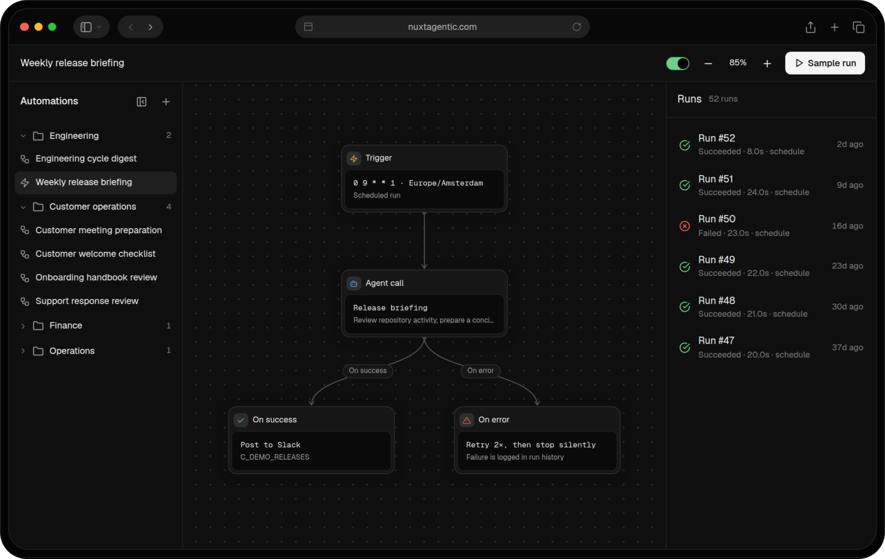

<div align="center">

<a href="https://nuxtagentic.com">
  
</a>

<sub>Pictured: the Nuxt Agentic Pro dashboard, built on this module.</sub>

# Nuxt Agentic

**Markdown agents and typed tools for Nuxt.**

Write an agent in Markdown, give it typed tools and stream every run into your UI.

[](https://npmjs.com/package/@nuxtagentic/nuxt)
[](https://npm.chart.dev/@nuxtagentic/nuxt)
[](./LICENSE)
[](https://nuxt.com)

**[Documentation](https://nuxtagentic.com/docs/getting-started/free)** ·
**[Examples](./examples)** ·
**[Website](https://nuxtagentic.com)** ·
**[Upgrade to Pro](./packages/nuxt/docs/upgrade-to-pro.md)**

</div>

## How it works

| Step | File                           | What you do                                                        |
| ---- | ------------------------------ | ------------------------------------------------------------------ |
| 01   | `server/agents/triage.md`      | Write instructions in Markdown; pick provider, model and tools     |
| 02   | `server/tools/lookup-issue.ts` | Define a tool with a Zod schema; arguments are validated for you   |
| 03   | `app/pages/triage.vue`         | Call `useAgent('triage')` and render each tool call and the answer |

## Quickstart

```bash
npx nuxi module add @nuxtagentic/nuxt
```

> During the release candidate, install the `next` tag: `npx nuxi module add @nuxtagentic/nuxt@next`.

Write an agent. The file name is its name; the frontmatter picks the model and tools.

```md [server/agents/triage.md]
---
provider: 'anthropic'
model: 'claude-sonnet-5-5'
tools: ['lookup_issue']
---

# Issue triage

Look up the issue, then reply with one label: bug, feature or question.
```

Give it a tool. `defineAgentTool` is auto-imported on the server.

```ts [server/tools/lookup-issue.ts]
import { z } from 'zod'

export default defineAgentTool({
  name: 'lookup_issue',
  description: 'Find a GitHub issue by number.',
  input: z.object({ number: z.number().int() }),
  handler: ({ number }, { signal }) =>
    $fetch(`https://api.github.com/repos/nuxt/nuxt/issues/${number}`, { signal }),
})
```

Run it from any page:

```ts
const { run, stop, messages, status } = useAgent('triage')
```

Set `NUXT_AGENTIC_ANTHROPIC_API_KEY` (or the OpenAI or Google key) and you are done. The
[module guide](./packages/nuxt/README.md) covers every option and the stream format.

## Features

- **Agents are Markdown**: instructions plus a small frontmatter for provider, model and tools.
- **Typed tools**: Zod input schemas, validated before your handler runs.
- **Streaming runs**: each step arrives as a server-sent event; `stop()` aborts the run and its tools.
- **Typed names**: `useAgent('triage')` only accepts agents that exist.
- **OpenAI, Anthropic and Google**, plus a deterministic `mock` provider for tests and demos.
- **DevTools tab** with your agents, tools and recent runs.
- **Runs anywhere Nitro does**: tested on Node and Cloudflare Workers.

## Examples

Each example runs on the mock provider without an API key.

| Example                                         | What it shows                                                                        |
| ----------------------------------------------- | ------------------------------------------------------------------------------------ |
| [`daily-digest`](./examples/daily-digest)       | Write a daily team digest with a Markdown agent on a Nitro scheduled task.           |
| [`issue-triage`](./examples/issue-triage)       | Triage GitHub-style issues with a Markdown agent, tools and an approval step.        |
| [`page-summarizer`](./examples/page-summarizer) | Summarize web pages with a Markdown agent and a fetch tool limited to allowed hosts. |

```bash
pnpm install && pnpm build
pnpm --dir examples/issue-triage dev
```

## Free and Pro

The module is MIT and free forever. [Nuxt Agentic Pro](https://nuxtagentic.com) builds a full
product around the same agents and tools.

| You need                                   | Nuxt Agentic | Nuxt Agentic Pro                  |
| ------------------------------------------ | ------------ | --------------------------------- |
| Markdown agents, typed tools, `useAgent()` | ✅           | ✅                                |
| Runs that survive a closed tab or a deploy |              | ✅ Durable runs                   |
| A person approves risky tool calls         |              | ✅ Approval inbox                 |
| Scheduled and event-driven work            |              | ✅ Automations                    |
| Gmail, Slack, GitHub, Linear and more      |              | ✅ Integrations with OAuth        |
| Sign-in, organizations and a dashboard     |              | ✅ Auth, workspaces, agent editor |

See [Upgrade to Pro](./packages/nuxt/docs/upgrade-to-pro.md) for the full comparison.

## Packages

| Package                                       | Description                                      |
| --------------------------------------------- | ------------------------------------------------ |
| [`@nuxtagentic/nuxt`](./packages/nuxt)        | The Nuxt module: agents, tools, `useAgent()`     |
| [`@nuxtagentic/engine`](./packages/engine)    | Framework-independent agent definitions and runs |
| [`@nuxtagentic/cli`](./packages/registry-cli) | Login, status and logout for the Pro registry    |

## Contributing

Bug reports, examples and fixes are welcome. Read [CONTRIBUTING.md](./CONTRIBUTING.md) for setup
and the checks CI runs.

## License

[MIT](./LICENSE) © Dennis Adriaansen
